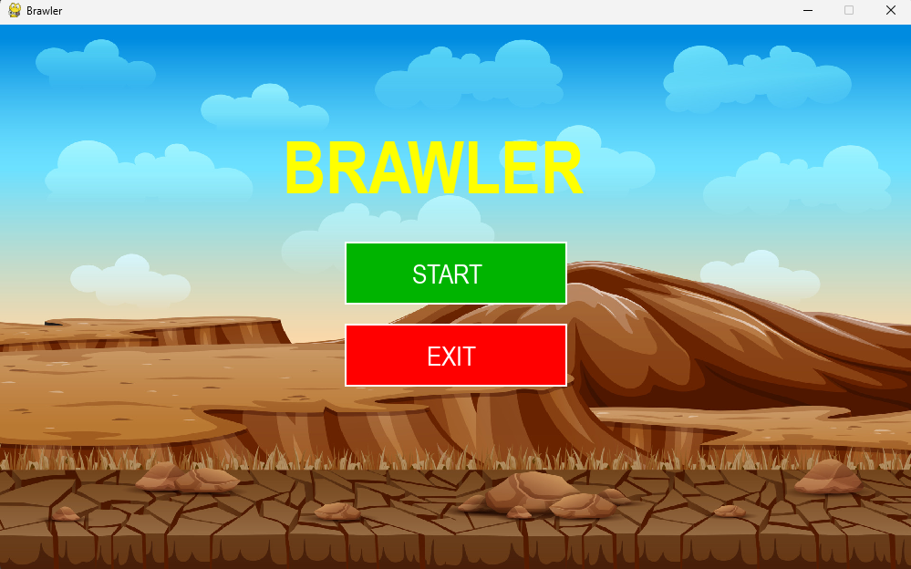
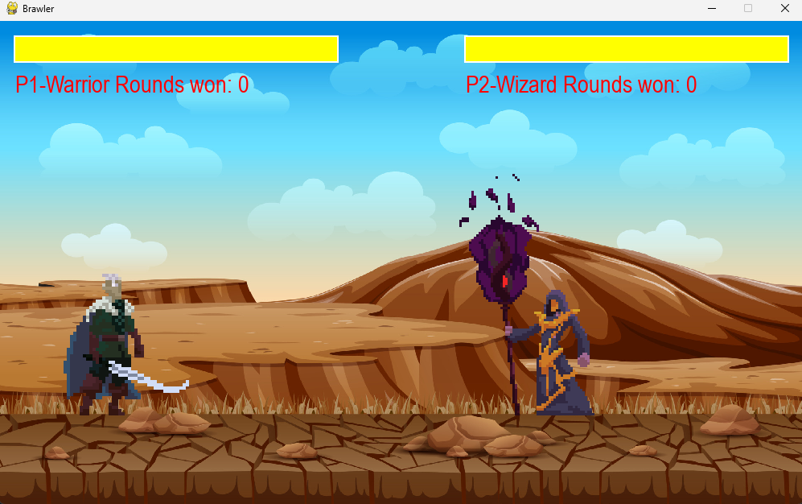
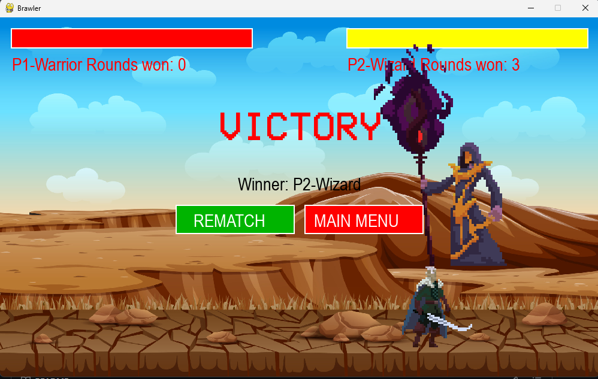

# Brawler

A fun and exciting 2D fighting game built using Python and the Pygame library!

## 🚀 About the Project
This is a 2-player local fighting game project where **P1-Warrior** and **P2-Wizard** face off across rounds with sprite animations, health bars, sound effects, a main menu, and a post-match victory screen with rematch and main menu options.

## 🛠️ Built With
- Python
- Pygame

## 📸 Screenshots

### Main Menu


### Gameplay


### Match Victory Screen


## 🙏 Acknowledgments & Credits
- Tutorial Series: Built by following the amazing tutorial by Coding With Russ. You can check out the tutorial here: https://youtu.be/s5bd9KMSSW4?si=qpVEI6qDXkVGl9bU.
- Creator: Coding With Russ on YouTube.

## ✨ Current Features
- **Multiple Game Modes:** Play **LOCAL 2P** on one keyboard, battle the **LOCAL 1P (BOT)** Wizard AI, or play **ONLINE** over a TCP relay server (`server.py`) with Portwarp tunneling support.
- **Fair Combat & Random Online Matchups:** Equalized horizontal attack reach for Warrior and Wizard, with random Warrior/Wizard assignment in online matches.
- **Online Lobby, Friend Codes & Invites:** Persistent player profiles saved locally in `Brawler_profile.json` and server-side in `users.json`, unique `BR-...` friend codes, live online/offline friend status, and match invites (`INVITE` / `ACCEPT` / `DECLINE`).
- **In-Game Instructions & Input Feedback:** Dedicated **INSTRUCTIONS** screen from the main menu and a blinking cursor in username and friend code input boxes.
- **Environment & Git Privacy:** Network/server configuration loaded via `.env` with `.gitignore` excluding `.env`, `random.txt`, `Brawler_profile.json`, and `users.json`.

## 🎮 Game Rules, Instructions & How to Play
### Match Rules
- Each match consists of up to **3 rounds**.
- Each fighter starts every round with **100 health** (`10` damage per successful attack).
- Winning a round awards a point to the surviving fighter (`Rounds won`).
- Whoever wins the most rounds across the 3 rounds wins the match.
- At the end of the match, the victory screen displays the **VICTORY** banner, plays the victory sound, announces the winner, resets both fighters to their idle first frame, scales the winner up, and downsizes the loser.
- Once a match ends, use **REMATCH** to play another match or **MAIN MENU** to return to the start screen.

### Controls
**Player 1 — Warrior:**
- Move Left / Right: `A` / `D`
- Jump: `W`
- Attack 1 / Attack 2: `E` / `Q`

**Player 2 — Wizard:**
- Move Left / Right: `Left Arrow` / `Right Arrow`
- Jump: `Up Arrow`
- Attack 1 / Attack 2: `Down Arrow` / `Right Ctrl`

## 📦 Things to Install (For Running From Source)
- **Python 3.x** (tested with Python 3.12)
- **Pygame**

## ⚙️ How to Play & Run

### Option 1: Play via `.exe` (No Python Installation Required)
1. Download or locate `dist/Brawler.exe` (v1) or [`dist/Brawler_V2.exe`](dist/Brawler_V2.exe) (v2) from this repository.
2. Double-click the `.exe` to launch the game and choose a mode or **EXIT** to quit.

### Option 2: Run From Source
1. Make sure you have Python and Pygame installed on your system:
   ```bash
   pip install pygame